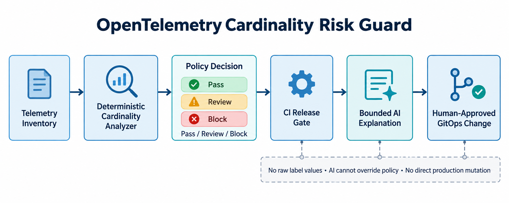

# OpenTelemetry Cardinality Risk Guard

[](https://github.com/ohjeffkuston/otel-cardinality-risk-guard/actions/workflows/ci.yml)

A deterministic release gate that detects dangerous metric-label cardinality before an OpenTelemetry pipeline reaches production. It estimates time-series growth, detects unbounded or sensitive dimensions, produces an auditable pass/review/block decision, and creates a bounded context payload for an optional AI explanation step.



## Production problem

Every unique combination of metric labels becomes a time series. A single unbounded dimension such as `session_id`, `user_id`, or `request_id` can multiply storage, memory, network, and query costs while also leaking sensitive identifiers into observability systems. This frequently appears only after a deployment, when rollback and cleanup are already expensive.

This project moves the control left: telemetry owners declare expected label cardinality, CI evaluates the projection, and the pipeline fails closed when a metric exceeds its budget or exposes a sensitive label.

## Why this is in demand

Current platform, DevOps, SRE, and AI-infrastructure postings repeatedly ask for Kubernetes, Terraform, GitOps, Prometheus, OpenTelemetry, SLOs, incident response, and production AI operations. The project demonstrates the intersection: observability engineering, policy automation, CI/CD governance, and guarded AI assistance.

Primary technical evidence:

- [Prometheus metric and label naming](https://prometheus.io/docs/practices/naming/) warns that each label combination creates a time series and advises against high-cardinality values such as user IDs and email addresses.
- [Prometheus instrumentation guidance](https://prometheus.io/docs/practices/instrumentation/) recommends investigating alternatives for metrics whose cardinality can exceed 100.
- [OpenTelemetry Collector processors](https://opentelemetry.io/docs/collector/components/processor/) documents processors that transform, filter, and enrich telemetry, including a cardinality guardian processor in contrib.

Live demand was checked on 2026-10-29 against current platform engineering postings that require combinations of Kubernetes, IaC, GitOps, Prometheus/OpenTelemetry, SLOs, and AI-platform operations. See [research notes](docs/research.md).

## Architecture and decision flow

1. A service owner submits a telemetry inventory with metric names, expected label counts, bounds, and sensitivity markers.
2. The deterministic analyzer calculates the Cartesian product of label values for projected active series.
3. Policy checks score budget pressure, unbounded dimensions, and sensitive identifiers.
4. CI emits a reproducible report and fails closed on a `block` decision.
5. A value-free AI context can explain the evidence, but it cannot change the deterministic decision or make production changes.
6. A human reviews the recommendation and updates OpenTelemetry Collector configuration through the normal GitOps process.

## Quick start

```bash
python -m venv .venv
source .venv/bin/activate
python -m pip install -e .
python -m unittest discover -s tests -v
```

Run the sample. It intentionally returns exit code `2` because `session_id` is sensitive and unbounded:

```bash
cardinality-guard examples/telemetry-inventory.json \
  --output report.json \
  --ai-context ai-context.json
```

To inspect a report without failing a local shell:

```bash
cardinality-guard examples/telemetry-inventory.json --fail-on never
```

## Input contract

```json
{
  "defaults": {"series_budget": 1000, "unbounded_threshold": 100},
  "metrics": [{
    "name": "api_http_requests_total",
    "labels": [
      {"name": "method", "distinct_values": 5, "bounded": true},
      {"name": "route", "distinct_values": 20, "bounded": true}
    ]
  }]
}
```

`projected_series` is the product of expected distinct values across labels. The decision is:

- `pass`: low projected cardinality and no sensitive dimensions;
- `review`: rising budget pressure or medium-risk labels;
- `block`: score at least 70 or any sensitive metric label.

## Tests and validation

The suite covers:

- safe bounded labels;
- budget-exceeding unbounded labels;
- sensitive-label blocking;
- deterministic output ordering;
- privacy-preserving AI context;
- CLI output and fail-closed exit behavior.

GitHub Actions installs the package, runs all tests, executes the risky sample, and verifies that the guard blocks it.

## Deployment guidance

Use the guard as a pull-request check before telemetry configuration is merged. The included OpenTelemetry Collector sample deletes sensitive attributes before export. Treat it as a starting point: validate component compatibility against your Collector distribution, stage changes in a non-production environment, observe active-series deltas, and roll out gradually.

Recommended operating sequence:

1. baseline active-series count and ingestion cost;
2. inventory the top metrics and label dimensions;
3. add conservative per-metric budgets;
4. run the guard in advisory mode;
5. tune false positives with evidence;
6. enforce blocking only after teams understand the policy;
7. review approved exceptions with expiry dates.

## Security, privacy, and failure modes

- Raw label values are never required or sent to an AI model.
- Sensitive dimensions cause a deterministic block even when their observed distinct count is small.
- The optional AI step receives only metric names, counts, risks, budgets, and deterministic recommendations.
- AI output is explanatory only; it cannot override the gate or modify a cluster.
- Inventory estimates can be wrong. Compare projections with production active-series data and keep a human approval gate.
- Removing a label can reduce diagnostic value. Move high-cardinality detail to controlled logs or traces instead of deleting evidence blindly.
- A static threshold cannot model every backend. Set budgets using real retention, ingestion, and query-cost data.

## Measurable outcomes

Track these before and after adoption:

- percentage of telemetry changes evaluated in CI;
- high-cardinality regressions caught before production;
- active-series growth per release;
- telemetry ingestion and storage cost;
- false-positive rate and approved-exception rate;
- mean time to identify the label responsible for a spike.

Success for the sample is deterministic: 100% test pass rate, risky configuration blocked, no raw label values in AI context, and identical output ordering across repeated runs.

## Trade-offs

Static declared counts are fast and testable but can drift from reality. Live backend queries improve accuracy but add credentials, availability dependencies, and production read access. This project deliberately keeps CI independent of production and recommends reconciling estimates through a separate, read-only evidence process.

## Interview positioning

Use this project to discuss:

- why label cardinality is multiplicative and operationally expensive;
- how to design a fail-closed policy without allowing AI to become the control plane;
- how privacy boundaries change an observability architecture;
- how to introduce governance gradually without blocking teams prematurely;
- how to measure value through avoided regressions, lower series growth, and faster diagnosis;
- why deterministic decisions plus bounded AI explanations are safer than an LLM-only gate.

This demonstrates production-minded SRE, platform engineering, policy automation, CI/CD, OpenTelemetry, Prometheus, Python testing, and responsible AI orchestration.

## Repository structure

```text
src/cardinality_guard/   deterministic analyzer, models, CLI, AI context
tests/                   unit and CLI integration tests
examples/                sample telemetry inventory
config/                  safe OpenTelemetry Collector example
docs/                    architecture, research, deployment notes
social/                  Medium, LinkedIn, and email-ready content
.github/workflows/       CI release gate validation
```

## License

MIT

